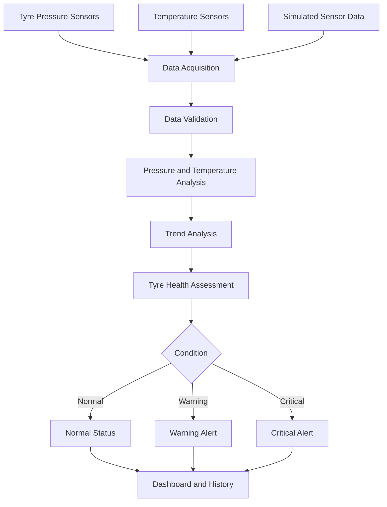

<div align="center">


<h3>Intelligent Automotive Safety & Predictive Maintenance</h3>

<p>
  An intelligent tyre monitoring system designed to track pressure and temperature,
  detect abnormal conditions, and support early warnings for potential tyre failures.
</p>


<br/>

<a href="https://github.com/rohanthanuj06-rgb">Developer Profile</a>
&nbsp; • &nbsp;
<a href="https://github.com/rohanthanuj06-rgb/PTMS/issues">Report an Issue</a>

</div>

---

## Overview

**PTMS — Predictive Tyre Monitoring System using TPMS for Cars** is an automotive safety project focused on intelligent tyre health monitoring, abnormal-condition detection, and predictive maintenance.

Tyres play a critical role in vehicle stability, braking performance, fuel efficiency, and road safety. Conventional tyre monitoring approaches may alert drivers only after a measured value crosses a predefined threshold.

PTMS aims to extend basic monitoring by considering changes in tyre pressure and temperature over time. This helps identify potentially unsafe conditions and provides an opportunity for earlier inspection and maintenance.

The project can be demonstrated through a software-based simulation and extended with compatible sensors and an ESP32 microcontroller.

### Core workflow

<div align="center">

```text
┌──────────────────────────────┐
│   Tyre Pressure & Temperature│
│          Monitoring          │
└──────────────┬───────────────┘
               ↓
┌──────────────────────────────┐
│       Data Acquisition       │
└──────────────┬───────────────┘
               ↓
┌──────────────────────────────┐
│    Data Processing & Checks  │
└──────────────┬───────────────┘
               ↓
┌──────────────────────────────┐
│    Threshold & Trend Analysis│
└──────────────┬───────────────┘
               ↓
┌──────────────────────────────┐
│      Tyre Health Assessment  │
└──────────────┬───────────────┘
               ↓
┌──────────────────────────────┐
│      Warning & Notification  │
└──────────────┬───────────────┘
               ↓
┌──────────────────────────────┐
│ Dashboard & Maintenance Logs │
└──────────────────────────────┘
```

</div>

## Why PTMS?

Tyre-related problems can develop gradually or occur unexpectedly. Monitoring pressure and temperature provides useful information about tyre condition, but individual readings may not reveal the complete situation.

PTMS focuses on combining monitoring with condition assessment.

- **Monitor:** Observe tyre pressure and temperature readings.
- **Analyze:** Compare sensor readings with configured limits.
- **Track:** Examine changes and trends across successive readings.
- **Detect:** Identify abnormal or potentially unsafe conditions.
- **Alert:** Notify users when readings or trends require attention.
- **Maintain:** Support timely inspection and preventive maintenance.

The goal is to improve driver awareness and support safer vehicle operation.

## Key Features

### 1. Tyre Health Monitoring

- Monitor pressure and temperature readings.
- Display the current condition of each monitored tyre.
- Identify readings outside configured operating limits.
- Support individual tyre monitoring when the required sensor inputs are available.

### 2. Predictive Condition Analysis

PTMS is designed to analyze sensor trends to help identify developing tyre problems.

Potential indicators include:

- Gradual pressure loss.
- Abnormal temperature increases.
- Repeated pressure fluctuations.
- Persistent deviations from expected readings.
- Pressure or temperature approaching configured limits.

The predictive capability depends on the implemented analysis logic and available historical data.

### 3. Intelligent Alert System

The system can classify conditions into three levels:

| Status | Meaning |
|---|---|
| 🟢 Normal | Readings are within configured limits. |
| 🟡 Warning | An abnormal reading or trend requires attention. |
| 🔴 Critical | A potentially unsafe condition requires prompt action. |

Alerts can be displayed on the monitoring dashboard or delivered through compatible hardware indicators and notification mechanisms.

### 4. Real-Time Dashboard

A monitoring interface can display:

- Tyre pressure and temperature.
- Individual tyre health status.
- Active warnings and critical alerts.
- Historical readings and trend charts.
- Sensor connectivity and system status.

### 5. Embedded System Integration

The hardware-oriented implementation can use an ESP32 and compatible pressure and temperature sensors to acquire measurements and trigger alerts.

Depending on the implemented setup, outputs may include an LCD or OLED display, buzzer, and status LEDs.

### 6. Simulation and Testing

A software-based prototype can simulate sensor readings and demonstrate normal, warning, and critical scenarios without requiring a physical vehicle or complete hardware assembly.

---

## Technology Stack

| Component | Technology | Purpose |
|---|---|---|
| Programming | Python | Monitoring logic and simulation |
| Microcontroller | ESP32 | Embedded control, when implemented |
| Pressure monitoring | TPMS or compatible pressure sensor | Tyre pressure measurement |
| Temperature monitoring | Compatible temperature sensor | Temperature measurement |
| Data analysis | Threshold rules and trend analysis | Condition assessment |
| Dashboard | Project-specific web interface | Visualization and monitoring |
| Hardware alerts | Buzzer, LEDs, or display | Local warning indication |
| Development | VS Code / Antigravity | Implementation and testing |

*The exact stack depends on the final implementation. Update the table to reflect the technologies and components actually used.*

---

## System Architecture



### Architectural components

**Sensor layer**

Collects pressure and temperature readings from compatible sensors or a software simulation.

**Data acquisition layer**

Receives measurements and prepares them for processing.

**Analysis layer**

Validates readings, checks configured thresholds, and analyzes trends.

**Decision layer**

Assigns an appropriate tyre health status based on available measurements and implemented rules.

**Alert layer**

Generates warnings when configured conditions are met.

**Visualization layer**

Displays tyre status, readings, alerts, and available historical information.

---

## Working Principle

1. **Data collection:** Obtain tyre pressure and temperature measurements.
2. **Data validation:** Check that the readings are valid and available.
3. **Threshold evaluation:** Compare measurements with configured safety limits.
4. **Trend analysis:** Examine successive readings for unusual changes.
5. **Health assessment:** Determine whether the tyre is normal, requires attention, or may be in an unsafe condition.
6. **Alert generation:** Display the appropriate warning when necessary.
7. **Monitoring and maintenance:** Review the readings and arrange inspection when required.

The system is intended to support driver decisions rather than replace physical tyre inspection or manufacturer safety recommendations.

---

## Project Structure

An example structure for the software-based implementation is shown below. Adapt it to your actual repository.

```text
PTMS/
│
├── app.py
├── main.py
│
├── sensors/
│   ├── pressure_sensor.py
│   └── temperature_sensor.py
│
├── monitoring/
│   ├── tyre_monitor.py
│   └── health_status.py
│
├── analysis/
│   ├── threshold_analysis.py
│   └── trend_analysis.py
│
├── alerts/
│   └── alert_manager.py
│
├── dashboard/
│
├── data/
│
├── tests/
│
├── requirements.txt
├── .gitignore
└── README.md
```

---

## Getting Started

### Prerequisites

- [Git](https://git-scm.com/)
- [Python](https://www.python.org/) if running the software-based implementation
- [Visual Studio Code](https://code.visualstudio.com/) or another compatible editor
- Required dependencies listed in `requirements.txt`, if provided

For the embedded implementation, install the appropriate ESP32 development environment and sensor libraries.

### 1. Clone the repository

```bash
git clone https://github.com/rohanthanuj06-rgb/PTMS.git
cd PTMS
```

> If your GitHub repository has a different name, replace `PTMS` in the URL and folder path.

### 2. Create a virtual environment

```bash
python -m venv venv
```

Activate it on Windows PowerShell:

```powershell
.\venv\Scripts\Activate.ps1
```

### 3. Install dependencies

If your project contains a `requirements.txt` file:

```bash
python -m pip install -r requirements.txt
```

### 4. Run the application

Use the entry-point command that matches your project. For example:

```bash
python app.py
```

If your main file has a different name, replace `app.py` accordingly.

For a hardware implementation, upload the appropriate firmware to the ESP32 and connect the compatible sensors according to the wiring configuration.

---

## Testing and Validation

The system can be evaluated using different simulated or measured tyre conditions.

| Test Scenario | Expected Behavior |
|---|---|
| Normal pressure and temperature | Normal status |
| Pressure below configured limit | Low-pressure warning |
| Pressure above configured limit | High-pressure warning |
| Temperature above configured limit | Temperature warning |
| Gradual pressure decline | Potential pressure-loss warning, if trend analysis is implemented |
| Missing or invalid readings | Data validation warning |

Use appropriate limits for the specific tyre and vehicle. Simulated tests demonstrate the behavior of the software but do not independently prove real-world tyre failure prediction accuracy.

---

## Applications

- Passenger vehicle safety monitoring.
- Fleet maintenance.
- Automotive engineering projects.
- Smart transportation systems.
- Predictive vehicle maintenance.
- Embedded systems and IoT research.

## Advantages

- Supports early identification of abnormal tyre conditions.
- Improves awareness of tyre pressure and temperature.
- Helps identify maintenance requirements.
- Can reduce reliance on occasional manual pressure checks when implemented with suitable sensors.
- Supports historical trend monitoring.
- Can be extended with IoT and machine learning technologies.

---

## Future Enhancements

- Machine learning-based tyre anomaly detection.
- Advanced pressure-loss trend prediction.
- Dedicated monitoring for all four tyres.
- Mobile application integration.
- Cloud-based storage and historical analytics.
- GPS-enabled fleet monitoring.
- Wireless sensor integration.
- Improved predictive models validated using real sensor data.
- Integration with vehicle telematics.

---

## Safety & Limitations

PTMS is a monitoring and decision-support prototype. Its warnings depend on sensor accuracy, configured limits, and the quality of the analysis.

- Predictive alerts do not guarantee advance detection of every tyre failure.
- Software simulation is not equivalent to physical vehicle testing.
- Sensor readings must be validated before safety-related decisions are made.
- Follow vehicle and tyre manufacturer recommendations.
- Never ignore a suspected unsafe tyre condition simply because the dashboard reports a normal status.

---

## Academic Project Information

**Project Title:** Predictive Tyre Monitoring System (PTMS) Using TPMS for Cars

**Domain:** Automotive Safety, Embedded Systems, IoT, and Predictive Maintenance

**Objective:** Develop an intelligent tyre monitoring solution that tracks pressure and temperature, identifies abnormal conditions, and supports early intervention.

**Implementation:** Software-based simulation with potential ESP32 and sensor integration.

---

## Developer

<div align="center">

<h3>Rohan Thanuj P</h3>

<p>B.Tech Information Technology | Automotive Safety & Intelligent Systems</p>

<a href="https://github.com/rohanthanuj06-rgb">

</a>

<br/><br/>

*Monitor smarter. Predict earlier. Drive safer.*


</div>
